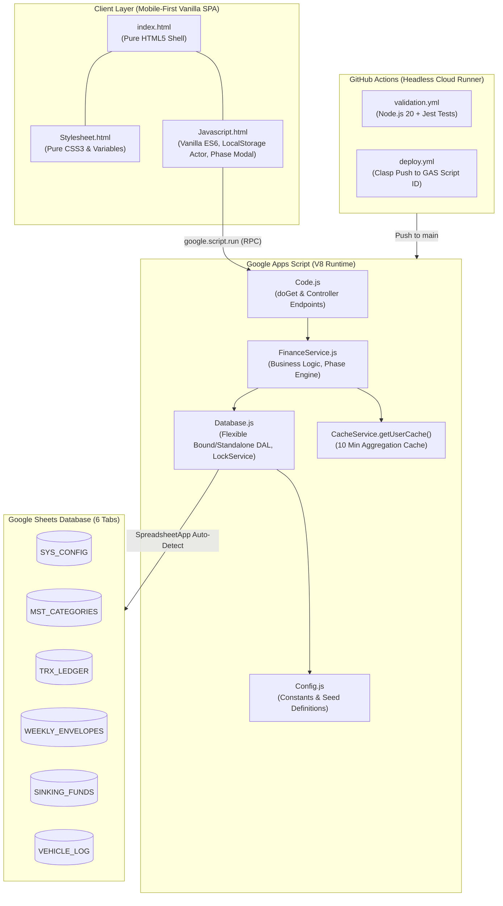

# FinKeluarga — Automated Family Financial Management System
## Implementation Plan (Final Approved Architecture)

FinKeluarga adalah sistem arsitektur manajemen keuangan keluarga 5 jiwa (Cinere, Depok – Jakarta) berbasis **Google Apps Script (V8 Engine)**, **Google Sheets Multi-Tab Database**, dan **Mobile-First Native Web App (`HtmlService`)**. Sistem ini menerapkan model transisi pengeluaran *Three-Phase Domino Effect* pada alokasi gaji tetap Rp17.000.000/bulan dengan sistem proteksi *concurrency* (`LockService`) serta pipeline CI/CD otomatis melalui **GitHub Actions** dan `@google/clasp`.

### Aturan Khusus Proyek:
1. **Zero Local Tooling Mandate:** Tidak perlu menginstall `node`, `npm`, atau `@google/clasp` pada host lokal. Node.js dan Clasp hanya berjalan di container runner GitHub Actions (`ubuntu-latest`).
2. **Artifact Persistence:** Seluruh file artifact (rencana implementasi, walkthrough, spesifikasi agent skill) disimpan langsung di dalam direktori proyek `/var/www/gas/personal_finance`.
3. **Keputusan User Review (Terkonfirmasi):**
   * **Koneksi Database Fleksibel:** `Database.getSpreadsheet()` mencoba `SpreadsheetApp.getActiveSpreadsheet()` terlebih dahulu, jika `null` (mode standalone) otomatis fallback ke `SpreadsheetApp.openById(CONFIG.SPREADSHEET_ID)`.
   * **Antarmuka Switch Fase Finansial:** UI Web App menyediakan kontrol switch fase (Fase 1 $\rightarrow$ Fase 2 $\rightarrow$ Fase 3) dilengkapi modal konfirmasi dialog pengaman sebelum mutasi dijalankan.
   * **Toggle Aktor Transaksi:** Form input mobile menyediakan tombol switch aktor `Suami` | `Istri` dengan persistensi status di `localStorage` peramban.

---

## User Review & Decisions

> [!NOTE]
> **1. Strategi Database Google Sheets Target [DISETUJUI]**
> * Implementasi menggunakan mekanisme auto-detect di [Database.js](file:///var/www/gas/personal_finance/src/Database.js):
>   ```javascript
>   function getSpreadsheet() {
>     const active = SpreadsheetApp.getActiveSpreadsheet();
>     if (active) return active;
>     if (CONFIG.SPREADSHEET_ID && CONFIG.SPREADSHEET_ID !== 'YOUR_SPREADSHEET_ID_HERE') {
>       return SpreadsheetApp.openById(CONFIG.SPREADSHEET_ID);
>     }
>     throw new Error('Spreadsheet ID belum dikonfigurasi pada Config.js');
>   }
>   ```

> [!NOTE]
> **2. Antarmuka Switch Fase dengan Dialog Pengaman [DISETUJUI]**
> * Pada dashboard Web App, disediakan indikator fase aktif dengan tombol *"Ubah Fase Finansial"*. Saat diklik, muncul modal dialog konfirmasi yang menjelaskan dampak pergeseran alokasi dana (misal: pengalihan dana transisi Anak 1 dan uang pangkal SMA ke tabungan kuliah Anak 3 dan Hari Tua) sebelum memanggil `apiSwitchPhase()`.

> [!NOTE]
> **3. Toggle Aktor Dinamis dengan `localStorage` [DISETUJUI]**
> * Tombol toggle segmen `Suami` | `Istri` di [index.html](file:///var/www/gas/personal_finance/src/index.html) dan [Javascript.html](file:///var/www/gas/personal_finance/src/Javascript.html) secara otomatis membaca dan menyimpan nilai terakhir ke `localStorage.getItem('finkeluarga_actor')`, sehingga pengguna tidak perlu memilih ulang setiap mencatat pengeluaran.

> [!IMPORTANT]
> **4. Zero Local Tooling Mandate [DISETUJUI]**
> * Tidak ada instalasi Node.js maupun Clasp pada host lokal. Pipeline CI/CD GitHub Actions menangani testing Jest dan `clasp push` secara otomatis.

---

## Architecture & Data Flow



---

## Proposed Changes

Struktur file lengkap yang akan dibuat di `/var/www/gas/personal_finance/`:

```text
/var/www/gas/personal_finance/
├── .github/
│   └── workflows/
│       ├── validation.yml             # [NEW] CI unit testing Jest di runner
│       └── deploy.yml                 # [NEW] CI/CD clasp push ke GAS
├── .gemini/
│   └── skills/
│       └── finkeluarga-core.md        # [NEW] Definisi skill agent Gemini CLI
├── src/
│   ├── appsscript.json               # [NEW] Manifest GAS (V8 runtime, timezone Jakarta)
│   ├── Code.js                       # [NEW] doGet, include(), RPC endpoints
│   ├── Config.js                     # [NEW] Master constants, 18 kategori Rp17jt, fase dominos
│   ├── Database.js                   # [NEW] DAL fleksibel, LockService, setupDatabase()
│   ├── FinanceService.js             # [NEW] Kalkulator amplop, sinking funds, EV commuter, switchPhase
│   ├── index.html                    # [NEW] Mobile-first SPA DOM container, modal switch fase, toggle aktor
│   ├── Stylesheet.html               # [NEW] Pure CSS3 design tokens & responsive components
│   └── Javascript.html               # [NEW] Vanilla ES6 reactive controller, optimistic UI, localStorage
├── tests/
│   ├── mockGoogleAppsScript.js       # [NEW] In-memory mock GAS API untuk testing di Node.js runner
│   └── finance.test.js               # [NEW] Unit test kalkulasi finansial & 3-fase domino
├── .clasp.json                       # [NEW] Konfigurasi rootDir ./src untuk clasp CI
├── .claspignore                      # [NEW] Filter file lokal agar tidak terunggah ke GAS
├── .gitignore                        # [NEW] Ignore file node_modules & OS artifacts
├── package.json                      # [NEW] Definisi devDependencies (Jest) untuk GitHub Actions
├── AGENT_SKILL_SPEC.md               # [MODIFY] Penambahan aturan zero local tooling & artifact storage
├── IMPLEMENTATION_PLAN.md            # [MODIFY] Artifact rencana implementasi di direktori kerja
└── README.md                         # [NEW] Panduan komprehensif setup & pairing secrets
```

---

### Component 1: Specifications & Agent Skills

#### [MODIFY] [AGENT_SKILL_SPEC.md](file:///var/www/gas/personal_finance/AGENT_SKILL_SPEC.md)
* Telah diperbarui dengan Aturan 8 (Zero Local Tooling) dan Aturan 9 (Penyimpanan Artifact di Direktori Kerja).

#### [NEW] [.gemini/skills/finkeluarga-core.md](file:///var/www/gas/personal_finance/.gemini/skills/finkeluarga-core.md)
* File spec skill agent siap pakai untuk Gemini CLI yang menyelaraskan seluruh instruksi di [AGENT_SKILL_SPEC.md](file:///var/www/gas/personal_finance/AGENT_SKILL_SPEC.md).

#### [MODIFY] [IMPLEMENTATION_PLAN.md](file:///var/www/gas/personal_finance/IMPLEMENTATION_PLAN.md)
* Rencana implementasi ini yang disimpan di direktori kerja `/var/www/gas/personal_finance/`.

---

### Component 2: Project Meta & CI/CD Pipeline

#### [NEW] [package.json](file:///var/www/gas/personal_finance/package.json)
* Konfigurasi script `test` dengan Jest untuk runner GitHub Actions:
```json
{
  "name": "finkeluarga",
  "version": "2.0.0",
  "description": "Automated Family Financial Management System for GAS & Google Sheets",
  "scripts": {
    "test": "jest --verbose"
  },
  "devDependencies": {
    "@google/clasp": "^2.4.2",
    "jest": "^29.7.0"
  }
}
```

#### [NEW] [.clasp.json](file:///var/www/gas/personal_finance/.clasp.json)
```json
{
  "scriptId": "PLACEHOLDER_INJECTED_BY_GITHUB_ACTIONS",
  "rootDir": "./src"
}
```

#### [NEW] [.claspignore](file:///var/www/gas/personal_finance/.claspignore)
```text
**/**
!src/**
!src/appsscript.json
!src/*.js
!src/*.html
```

#### [NEW] [.gitignore](file:///var/www/gas/personal_finance/.gitignore)
* Mengabaikan `.clasprc.json`, `node_modules/`, log, dan file cache sementara.

#### [NEW] [.github/workflows/validation.yml](file:///var/www/gas/personal_finance/.github/workflows/validation.yml)
* Menjalankan unit test Jest dan syntax audit pada runner Node.js 20 saat ada push / pull request.

#### [NEW] [.github/workflows/deploy.yml](file:///var/www/gas/personal_finance/.github/workflows/deploy.yml)
* Otomatisasi deployment ke GAS melalui `@google/clasp` menggunakan secret `CLASPRC_JSON` dan `SCRIPT_ID` saat push ke cabang `main`.

---

### Component 3: Google Apps Script Backend (`src/`)

#### [NEW] [src/appsscript.json](file:///var/www/gas/personal_finance/src/appsscript.json)
* Runtime V8, `timeZone: "Asia/Jakarta"`, OAuth scopes:
  - `https://www.googleapis.com/auth/spreadsheets`
  - `https://www.googleapis.com/auth/script.container.ui`

#### [NEW] [src/Config.js](file:///var/www/gas/personal_finance/src/Config.js)
* Memuat seluruh konstanta terpusat:
  - `SPREADSHEET_ID`: `'YOUR_SPREADSHEET_ID_HERE'` (dapat diisi jika standalone, atau dibiarkan placeholder jika bound).
  - Definisi 6 tab: `SYS_CONFIG`, `MST_CATEGORIES`, `TRX_LEDGER`, `WEEKLY_ENVELOPES`, `SINKING_FUNDS`, `VEHICLE_LOG`.
  - Master data 18 kategori pengeluaran alokasi Rp17.000.000 lengkap dengan pembagian Grup A, B, C, D, E.
  - Alokasi anggaran bulanan untuk Fase 1, Fase 2, dan Fase 3.
  - Plafon amplop mingguan Dapur (Rp1.050.000) dan Kantor (Rp300.000).
  - Target Sinking Funds (SMA Anak 3, Cadangan UKT Anak 2, Dana Kuliah Anak 3, Hari Tua, Dana Darurat).
  - Parameter cache (600 detik) dan lock timeout (15.000 ms).

#### [NEW] [src/Database.js](file:///var/www/gas/personal_finance/src/Database.js)
* Data Access Layer:
  - `Database.getSpreadsheet()`: Fleksibel mendeteksi Container-Bound vs Standalone.
  - `Database.setupDatabase()`: Membuat 6 tab lengkap, memformat header, menyetel data validation, dan menyuntikkan data *seed* awal jika tab kosong.
  - `Database.batchAppend(sheetName, rowArray)`: Append baris dengan pembungkus `LockService`.
  - `Database.readSheetData(sheetName)`: Batch read data spreadsheet.
  - `Database.updateRow(sheetName, rowIndex, rowData)`: Batch update baris.

#### [NEW] [src/FinanceService.js](file:///var/www/gas/personal_finance/src/FinanceService.js)
* Financial Engine:
  - `FinanceService.getBootstrapData()`: Mengambil snapshot data lengkap untuk UI dalam 1 payload (konfigurasi fase, amplop mingguan ISO-8601, sinking funds, 15 transaksi terakhir, analitik komuter EV) dengan dukungan cache `CacheService.getUserCache()`.
  - `FinanceService.createTransaction(payload)`: Mutasi transaksi di dalam `LockService(15000)`, rekalkulasi amplop mingguan atau tabungan tujuan, dan invalidasi cache.
  - `FinanceService.switchPhase(newPhase)`: Mengubah fase pada tab `SYS_CONFIG`, memperbarui alokasi anggaran aktif, dan invalidasi cache.
  - `FinanceService.recordVehicleLog(payload)`: Mencatat log komuter Cinere–Jakarta dan konsumsi energi EV.

#### [NEW] [src/Code.js](file:///var/www/gas/personal_finance/src/Code.js)
* Controller Web App:
  - `doGet(e)`: Merender `index.html`, menyuntikkan data awal `initialDataJson`.
  - `include(filename)`: Modular include untuk `Stylesheet` dan `Javascript`.
  - RPC Controllers: `apiGetBootstrapData()`, `apiCreateTransaction(payload)`, `apiRecordVehicleLog(payload)`, `apiSwitchPhase(newPhase)`, `apiSetupDatabase()`.

---

### Component 4: Native Mobile-First Frontend (`src/`)

#### [NEW] [src/Stylesheet.html](file:///var/www/gas/personal_finance/src/Stylesheet.html)
* Zero-Dependency Pure CSS3:
  - CSS Variables (`--color-primary: #0f766e`, `--color-status-ok: #16a34a`, `--color-status-warn: #d97706`, `--color-status-alert: #dc2626`, dll).
  - Desain responsif mobile (layar 360px - 430px smartphone).
  - Progress bar CSS murni tanpa external library.
  - Modal dialog konfirmasi modern untuk Switch Fase Finansial.
  - Segmented toggle button yang ramah jempol (touch target >= 44px) untuk pilihan aktor `Suami` | `Istri`.
  - Bottom navigation bar dengan icon inline SVG.
  - Pure CSS spinner & alert toast.

#### [NEW] [src/index.html](file:///var/www/gas/personal_finance/src/index.html)
* Semantic SPA DOM Container:
  - Header dengan status Fase aktif dan tombol *"Ganti Fase"*.
  - Modal dialog konfirmasi perpindahan fase (*Fase 1: Transisi & SMA Anak 3*, *Fase 2: Kuliah Anak 3 & Peningkatan Hari Tua*, *Fase 3: Kemandirian Penuh*).
  - View 1: `#view-dashboard` (Amplop Dapur & Kantor, pengeluaran bulan ini, riwayat transaksi).
  - View 2: `#view-input` (Formulir transaksi cepat dengan toggle aktor `Suami` | `Istri`, kategori dropdown, input nominal cerdas).
  - View 3: `#view-sinking` (Kartu target dana tabungan).
  - View 4: `#view-vehicle` (Log komuter Cinere-Jakarta & perbandingan efisiensi EV vs PCX).
  - Bottom navigation bar.

#### [NEW] [src/Javascript.html](file:///var/www/gas/personal_finance/src/Javascript.html)
* Vanilla ES6 Controller:
  - Initialisasi data dari scriptlet `window.INITIAL_DATA`.
  - Persistensi Aktor: Membaca dan menyimpan aktor aktif ke `localStorage.getItem('finkeluarga_actor')`.
  - Logika modal Switch Fase: Menampilkan ringkasan dampak finansial, mengeksekusi `google.script.run.apiSwitchPhase()`, dan memuat ulang bootstrap data.
  - Optimistic UI updates untuk pencatatan transaksi.
  - Formatter Rupiah (`Intl.NumberFormat('id-ID')`) dan helper tanggal ISO.

---

### Component 5: Tests & Documentation

#### [NEW] [tests/mockGoogleAppsScript.js](file:///var/www/gas/personal_finance/tests/mockGoogleAppsScript.js)
* Mock API GAS untuk test runner Jest di GitHub Actions.

#### [NEW] [tests/finance.test.js](file:///var/www/gas/personal_finance/tests/finance.test.js)
* Unit tests memverifikasi:
  1. Total alokasi 18 kategori tepat Rp17.000.000.
  2. Logika pergeseran dana 3-fase domino effect.
  3. Plafon amplop mingguan (Dapur Rp1.050.000, Kantor Rp300.000).
  4. Formula penghematan komuter Cinere-Jakarta EV vs PCX.
  5. Perhitungan ISO Week `YYYY-Www`.

#### [NEW] [README.md](file:///var/www/gas/personal_finance/README.md)
* Dokumentasi lengkap instalasi, inisialisasi database satu klik, setup secret CI/CD di GitHub, dan deployment Web App.

---

## Verification Plan

### Automated Tests (GitHub Actions & Local Syntax Check)
1. **Local Guardrails Verification:**
   - Memastikan tidak ada modul `import`/`export` pada file di dalam `src/`.
   - Memastikan tidak ada URL eksternal CDN pada file HTML/CSS.
   - Memastikan total alokasi 18 kategori tepat Rp17.000.000 pada `Config.js`.
2. **GitHub Actions Workflow Validation:**
   - Script otomatis menjalankan `npm test` di workflow `.github/workflows/validation.yml`.

### Manual Verification
1. **Google Sheets Auto-Detect & Setup:**
   - Jalankan `Database.setupDatabase()` -> verifikasi 6 tab terbuat dengan relasi dan data seeding.
2. **Web App Experience:**
   - Buka Web App -> verifikasi toggle Suami/Istri tersimpan saat direfresh (`localStorage`).
   - Uji coba tombol "Ganti Fase" -> modal dialog konfirmasi muncul -> konfirmasi switch fase -> badge fase dan alokasi anggaran berubah.
   - Catat transaksi -> amati *optimistic update* dan verifikasi penambahan baris pada `TRX_LEDGER`.
